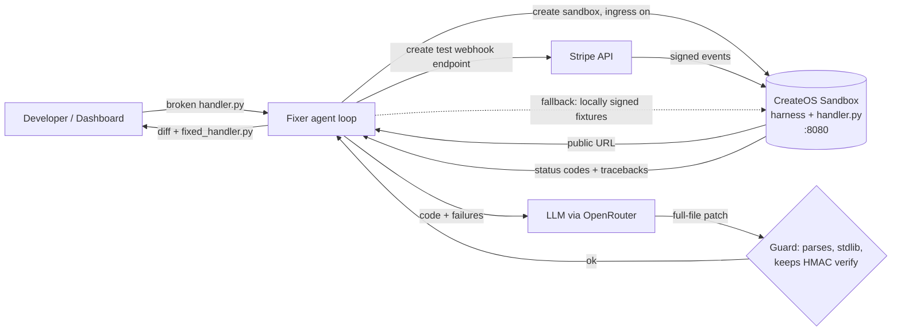

# 🪝 Stripe Webhook Fixer

**Live demo (hosted on CreateOS, offline mode):** https://dep-ea9f8477-dda0-40f0-835c-ccd06b2f5a4c.tyzo.nodeops.app  
**Stripe Projects share:** https://projects.dev/s#v1:createos~project

**An agent that runs your broken Stripe webhook handler in a CreateOS sandbox, fires real signed Stripe
events at its public HTTPS URL, reads the tracebacks, and rewrites the code until every event returns 200,
without ever dropping signature verification.**

Built for the CreateOS × Stripe Projects hackathon. Theme: *Build agents that run code.*

## The problem

Webhook handlers fail quietly. A renamed field, a `KeyError` on a nullable property or an event type
nobody handled returns a 500. Stripe retries for 3 days, then **disables the endpoint**, and customers stop
getting provisioned, dunned or de-provisioned. The common "fix" makes things worse: people turn off
signature verification to get past a 400, so anyone can POST a fake `payment_intent.succeeded`.

**Who it's for:** SaaS developers and founders who take payments with Stripe and don't want to debug
webhooks at 2 AM.

## What the agent does

1. Starts a **CreateOS sandbox** (`s-1vcpu-1gb`, `devbox:1`) with **ingress enabled**, so the handler gets a public URL.
2. Uploads a fixed stdlib harness plus your `handler.py`, and starts it on `0.0.0.0:8080`.
3. Sends Stripe events at the public URL (see *Delivery modes*), plus a **forged-signature probe** that must be rejected.
4. Collects status codes, the per-request log and server tracebacks from inside the sandbox.
5. Asks an LLM for a **full-file rewrite**. Every patch is checked: it must parse, define `handle()`, use only the stdlib, and keep
   `hmac.compare_digest` verification. A patch that fails the check is never deployed.
6. Redeploys and replays until everything is green (max 5 iterations), then prints the **diff** and saves `fixed_handler.py`.
7. Always destroys the sandbox and deletes the Stripe test endpoint (`finally`).

The example handler (`examples/broken_handler.py`) has 4 realistic bugs:

| Event | Bug | Before | After |
|---|---|---|---|
| any | only checks that the header exists, never verifies the HMAC on the raw body | forged event **accepted (200)** | 400 |
| `checkout.session.completed` | `event["data"]["customer_email"]` (wrong path) | 500 KeyError | 200 |
| `invoice.payment_failed` | assumes `customer_email` is set and `last_payment_error` exists | 500 | 200 |
| `customer.subscription.deleted` | unhandled type, so it raises | 500 | 200 |
| `payment_intent.succeeded` | fine | 200 | 200 |

## How it uses Stripe Projects + CreateOS

- **Stripe Projects** sets up the stack: `stripe projects add createos/project` creates the CreateOS account and
  writes the sandbox credentials into `.env`. (OpenRouter is also in the Projects catalog: `stripe projects catalog openrouter`.)
- **CreateOS Sandbox** runs the untrusted, AI-written code in isolation, with a public ingress URL so that Stripe itself can deliver webhooks to it.
- **Stripe** sends the events. In `stripe` mode the agent creates a real test-mode webhook endpoint pointing at the sandbox and fires events with `stripe trigger`.



## Setup

```bash
cd webhook-fixer
python3 -m venv .venv && . .venv/bin/activate
pip install -r requirements.txt

# Stripe Projects: provisions CreateOS and writes credentials into .env
stripe plugin install projects
stripe projects init webhook-fixer && stripe projects add createos/project
stripe projects env            # lists variable names (values hidden)

cp -n .env.example .env        # then add OPENROUTER_API_KEY (and STRIPE_SECRET_KEY for stripe mode)
```

### Environment variables

| Var | Needed for | Notes |
|---|---|---|
| `CREATEOS_API_KEY` | sandbox | read by the Python SDK; `CREATEOS_SANDBOX_API_KEY` also accepted |
| `OPENROUTER_API_KEY` | LLM | base URL `https://openrouter.ai/api/v1`; or set `OPENAI_API_KEY` |
| `FIXER_MODEL` | optional | default `anthropic/claude-sonnet-4` (OpenRouter) / `gpt-4o-mini` (OpenAI) |
| `STRIPE_SECRET_KEY` | `--delivery stripe` | **test mode** `sk_test_...`; plus the `stripe` CLI on PATH |
| `SANDBOX_SHAPE`, `SANDBOX_ROOTFS` | optional | defaults `s-1vcpu-1gb`, `devbox:1` |

## Run

```bash
# Offline demo / test: local subprocess "sandbox" + scripted mock LLM, no keys needed
python -m fixer run examples/broken_handler.py --dry-run

# Real: CreateOS sandbox + LLM, locally signed Stripe events sent to the public URL (default, most robust)
python -m fixer run examples/broken_handler.py \
  --events checkout.session.completed,invoice.payment_failed,customer.subscription.deleted,payment_intent.succeeded

# Real Stripe delivery: creates a test webhook endpoint at the sandbox URL and runs `stripe trigger`
python -m fixer run examples/broken_handler.py --delivery stripe

# Dashboard: live red to green grid, sandbox logs and diff
streamlit run app.py

# Tests
python -m pytest -q
```

Outputs go to `out/`: `fixed_handler.py`, `fix.diff`, `report.json`.

### Delivery modes

- **`local` (default):** builds realistic Stripe event payloads, signs them exactly as Stripe does
  (`Stripe-Signature: t=…,v1=HMAC_SHA256(secret, "t.raw_body")`) with a per-run `whsec_` secret, and POSTs them to the
  sandbox's public URL. If ingress is unreachable it POSTs over loopback inside the sandbox, so the demo
  still runs.
- **`stripe`:** `POST /v1/webhook_endpoints` (test mode) gets a real signing secret. `stripe trigger <event>` creates real
  objects, and Stripe delivers the resulting events to the sandbox. Status codes are read from the harness request log.
  The endpoint is deleted at the end.

## Layout

```
webhook-fixer/
├── app.py                    # Streamlit dashboard
├── fixer/
│   ├── __main__.py           # CLI (python -m fixer run ...)
│   ├── loop.py               # agent loop, patch guard, diff
│   ├── sandbox.py            # CreateOSSandbox (SDK) + LocalSandbox (dry run)
│   ├── delivery.py           # signed replay + real Stripe endpoint / stripe trigger
│   ├── events.py             # Stripe event fixtures + signing
│   ├── llm.py                # OpenRouter/OpenAI client + MockLLM
│   ├── harness/server.py     # stdlib HTTP harness that runs inside the sandbox
│   └── mock_patches/         # scripted patches for --dry-run
├── examples/broken_handler.py
└── tests/test_fixer.py
```

## Safety

- AI-written code only ever runs inside the CreateOS sandbox (or a local subprocess in dry-run mode).
- Patches that remove HMAC verification are refused, and the forged-signature probe checks behaviour on every iteration.
- Only Stripe **test mode** keys are accepted. Sandboxes and endpoints are torn down in `finally`.
